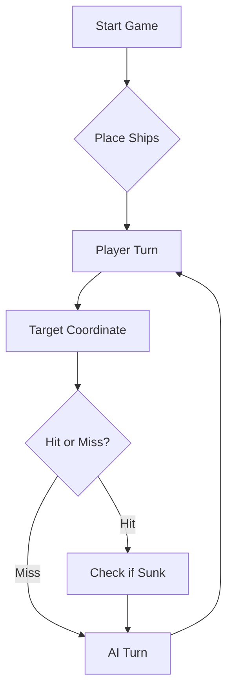

Link Youtube: https://www.youtube.com/watch?v=3f6PsAW-0so

# ⚓ Battleship 2.0


> A modern take on the classic naval warfare game, designed for the XVII century setting with updated software engineering patterns.

---

## 📖 Table of Contents
- [Project Overview](#-project-overview)
- [Key Features](#-key-features)
- [Technical Stack](#-technical-stack)
- [AI Opponent Strategy](#-estratégia-do-oponente-de-ia-prompt-final)
- [Installation & Setup](#-installation--setup)
- [Code Architecture](#-code-architecture)
- [Roadmap](#-roadmap)
- [Contributing](#-contributing)

---

## 🎯 Project Overview
This project serves as a template and reference for students learning **Object-Oriented Programming (OOP)** and **Software Quality**. It simulates a battleship environment where players must strategically place ships and sink the enemy fleet.

### 🎮 The Rules
The game is played on a grid (typically 10x10). The coordinate system is defined as:

$$(x, y) \in \{0, \dots, 9\} \times \{0, \dots, 9\}$$

Hits are calculated based on the intersection of the shot vector and the ship's bounding box.

---

## ✨ Key Features
| Feature | Description | Status |
| :--- | :--- | :---: |
| **Grid System** | Flexible $N \times N$ board generation. | ✅ |
| **Ship Varieties** | Galleons, Frigates, and Brigantines (XVII Century theme). | ✅ |
| **PDF Export** | Export game move history and fleet state to PDF. | ✅ |
| **AI Opponent** | Heuristic-based targeting system. | 🚧 |
| **Network Play** | Socket-based multiplayer. | ❌ |

---

## 🧠 Estratégia do Oponente de IA (Prompt Final)

O oponente de IA foi instruído e treinado com recurso a *few-shot prompting* e heurísticas táticas para o tabuleiro da Batalha Naval dos Descobrimentos (grelha 10x10, A-J e 1-10, frota de 11 navios sem contacto mútuo, nem nas diagonais).

Abaixo encontra-se a prompt final utilizada para orientar a tomada de decisão da IA:

```text
Atue como um comandante especialista em Batalha Naval da era dos Descobrimentos Portugueses, jogando num tabuleiro de linhas A a J e colunas 1 a 10, contra uma frota de 11 navios (4 Barcas, 3 Caravelas, 2 Naus, 1 Fragata e 1 Galeão em forma de T) que não se tocam, nem mesmo por cantos/diagonais.

Em cada jogada deve disparar exatamente uma rajada de 3 tiros em formato JSON:
[
  {"row": "<LINHA>", "column": <COLUNA>},
  {"row": "<LINHA>", "column": <COLUNA>},
  {"row": "<LINHA>", "column": <COLUNA>}
]

Para maximizar a eficiência e afundar a frota no menor número possível de rajadas, siga rigorosamente as seguintes heurísticas:

1. Diário de Bordo (Memória Persistente):
   - Mantenha o registo de todas as quadrículas testadas: ÁGUA, ACERTO ou AFUNDADO.
   - NUNCA repita coordenadas anteriormente testadas nem dispare fora dos limites (A-J, 1-10).

2. Modo Caça (Paridade e Distribuição):
   - Enquanto procura navios não identificados, utilize um padrão de dispersão baseado em paridade (estilo xadrez) com espaçamento de pelo menos 2 quadrículas, maximizando a probabilidade de intercetar os navios maiores (Naus, Fragata e Galeão).

3. Modo Foco / Perseguição (Target Mode):
   - Ao obter um acerto num navio que ainda não foi afundado, priorize na rajada seguinte as posições ortogonalmente contíguas (Norte, Sul, Este, Oeste).
   - Assim que dois acertos no mesmo navio revelarem a sua orientação (horizontal ou vertical), continue o ataque exclusivamente nas extremidades desse segmento retilíneo até afundar a embarcação.

4. Regra de Exclusão Diagonal:
   - Como os navios não se podem tocar nas diagonais, qualquer célula diagonal a um acerto confirmado num navio reto é garantidamente ÁGUA. Marque essas células como água no seu mapa mental e nunca gaste tiros nelas.

5. Halo de Água Pós-Afundamento (Perímetro de Segurança):
   - Quando a resposta indicar que um navio foi afundado (ex: Caravela, Nau, Fragata ou Galeão), identifique as coordenadas que formavam o corpo desse navio e marque TODO o perímetro envolvente (halo de 1 quadrícula ao redor) como ÁGUA CONFIRMADA. Nenhum outro navio pode estar encostado a essa área.

6. Otimização da Rajada:
   - Aloque sempre os 3 tiros da rajada de forma eficiente: utilize os tiros necessários para perseguir navios já atingidos e os tiros sobrantes para prosseguir a exploração (modo caça) em quadrículas com maior densidade de probabilidade.
```

---

## 🛠 Technical Stack
* **Language:** Java 17
* **Build Tool:** Maven / Gradle
* **Testing:** JUnit 5
* **Logging:** Log4j2

---

## 🚀 Installation & Setup

### Prerequisites
* JDK 17 or higher
* Git

### Step-by-Step
1. **Clone the repository:**
   ```bash
   git clone https://github.com/britoeabreu/Battleship2.git
   ```
2. **Navigate to directory:**
   ```bash
   cd Battleship2
   ```
3. **Compile and Run:**
   ```bash
   javac Main.java && java Main
   ```

---

## 📚 Documentation

You can access the generated Javadoc here:

👉 [Battleship2 API Documentation](https://britoeabreu.github.io/Battleship2/)


### Core Logic
```java
public class Ship {
    private String name;
    private int size;
    private boolean isSunk;

    // TODO: Implement damage logic
    public void hit() {
        // Implementation here
    }
}
```

### Design Patterns Used:
- **Strategy Pattern:** For different AI difficulty levels.
- **Observer Pattern:** To update the UI when a ship is hit.
</details>

### Logic Flow


---

## 🗺 Roadmap
- [x] Basic grid implementation
- [x] Ship placement validation
- [x] PDF export of game reports
- [ ] Add sound effects (SFX)
- [ ] Implement "Fog of War" mechanic
- [ ] **Multiplayer Integration** (High Priority)

---

## 🧪 Testing
We use high-coverage unit testing to ensure game stability. Run tests using:
```bash
mvn test
```

> [!TIP]
> Use the `-Dtest=ClassName` flag to run specific test suites during development.

---

## 🤝 Contributing
Contributions are what make the open-source community such an amazing place to learn, inspire, and create.

1. Fork the Project
2. Create your Feature Branch (`git checkout -b feature/AmazingFeature`)
3. Commit your Changes (`git commit -m 'Add some AmazingFeature'`)
4. Push to the Branch (`git push origin feature/AmazingFeature`)
5. Open a **Pull Request**

---

## 📜 License
Distributed under the MIT License. See `LICENSE` for more information.

---
**Maintained by:** [@britoeabreu](https://github.com/britoeabreu)  
*Created for the Software Engineering students at ISCTE-IUL.*
